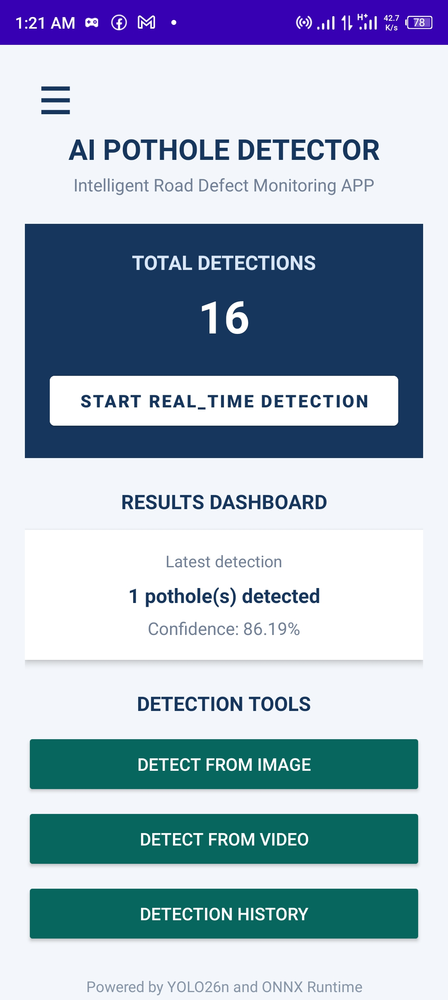
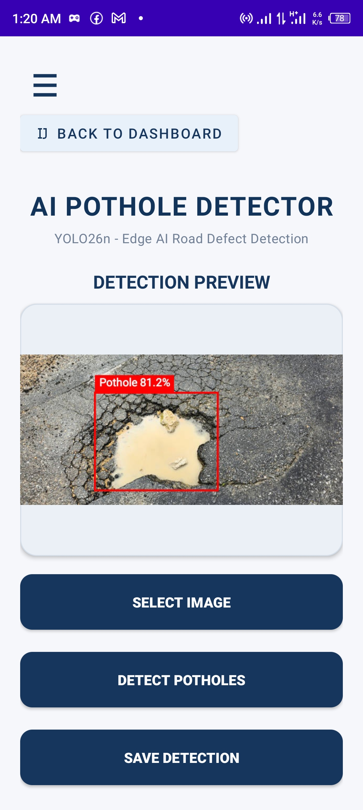
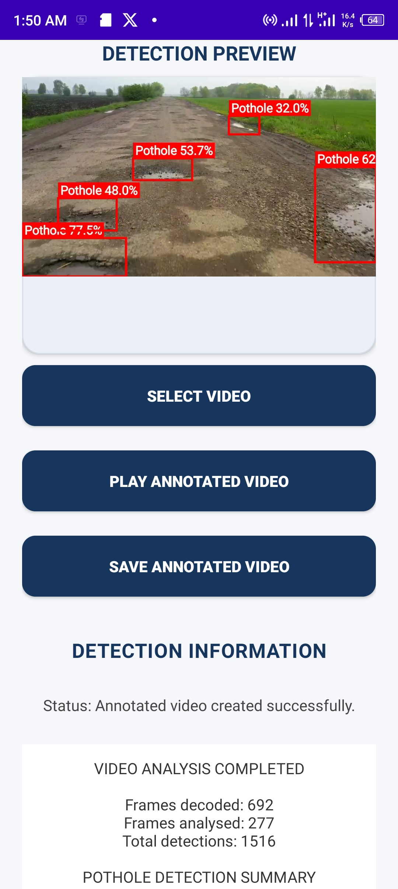
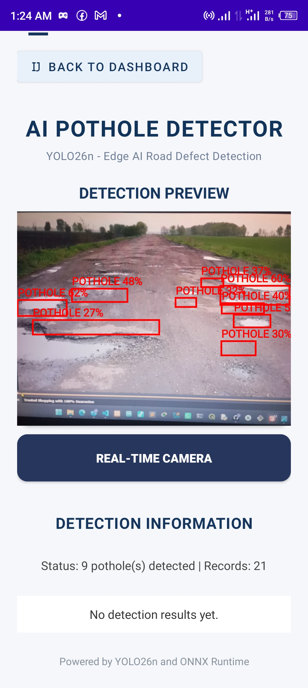

# AI Pothole Detector

An AI-powered Android application for detecting potholes using deep learning and computer vision. The application uses a YOLO26n model exported to ONNX format and runs inference directly on Android devices.

## Project Overview

AI Pothole Detector is an MSc Artificial Intelligence project designed to detect potholes in road environments using image processing, video analysis, and real-time camera detection.

## Features

- Image-based pothole detection.
- Video-based pothole detection.
- Real-time camera detection.
- Bounding-box visualization.
- Detection confidence scores.
- Detection history.
- Local detection record storage.
- Annotated video generation and playback.

## AI Model

| Property | Details |
|---|---|
| Model | YOLO26n |
| Model format | ONNX |
| Inference engine | ONNX Runtime |
| Input size | 640 × 640 |
| Input tensor | [1, 3, 640, 640] |
| Output tensor | [1, 7, 8400] |
| Classes | Cracks, Patching, Pothole |
| Application detection focus | Potholes |

The trained model is located at:

`app/src/main/assets/best.onnx`

## Technology Stack

- Kotlin
- Android Studio
- YOLO26n
- ONNX Runtime
- CameraX
- Android SDK
- Gradle

## Project Structure

```text
PotholeDetection/
│
├── app/
│   └── src/
│       └── main/
│           ├── assets/
│           │   └── best.onnx
│           ├── java/
│           │   └── com/sani/potholedetector/
│           ├── res/
│           └── AndroidManifest.xml
│
├── gradle/
├── build.gradle
├── gradle.properties
├── settings.gradle
├── gradlew
├── gradlew.bat
└── README.md
```

## Installation and Setup

1. Install Android Studio.
2. Clone this repository:

   ```bash
   git clone github.com/sanihassan-56/AI-Pothole-Detector-Android
   ```

3. Open the project in Android Studio.
4. Allow Gradle to synchronize.
5. Connect an Android device or start an emulator.
6. Build and run the application.

## Android Dependencies

The project uses Gradle dependencies, including:

- ONNX Runtime Android
- CameraX
- AndroidX AppCompat
- AndroidX Core KTX
- Material Components
- ConstraintLayout

The exact dependency versions are maintained in the project's Gradle configuration.

## Application Package

`com.sani.potholedetector`

## Developer

**Sani Hassan Muhammad**

MSc Artificial Intelligence Project.

## License

License information will be added separately.

## System Architecture

The Android application uses an offline edge-AI architecture powered by YOLO26n and ONNX Runtime.

```mermaid
flowchart TD
    A["User"] --> B["AI Pothole Detector App"]

    B --> C["Image Detection"]
    B --> D["Video Detection"]
    B --> E["Real-Time Camera Detection"]

    C --> F["Image Preprocessing"]
    D --> F
    E --> F

    F --> G["YOLO26n ONNX Model"]

    G --> H["ONNX Runtime Inference"]
    H --> I["Detection Postprocessing"]
    I --> J["Pothole Class Filtering"]

    J --> K["Bounding Boxes and Confidence Scores"]

    K --> L["Detection Results Dashboard"]
    K --> M["Detection History"]
    K --> N["Annotated Video Output"]

## Application Screenshots

### Home Dashboard


### Image-Based Pothole Detection


### Video-Based Pothole Detection


### Real-Time Pothole Detection
